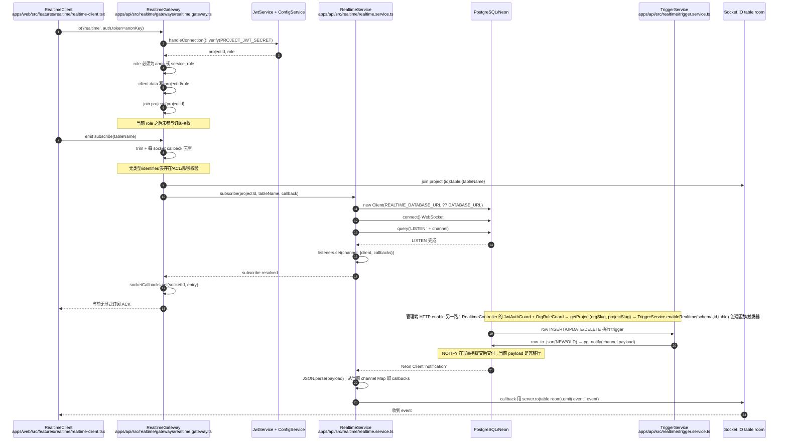
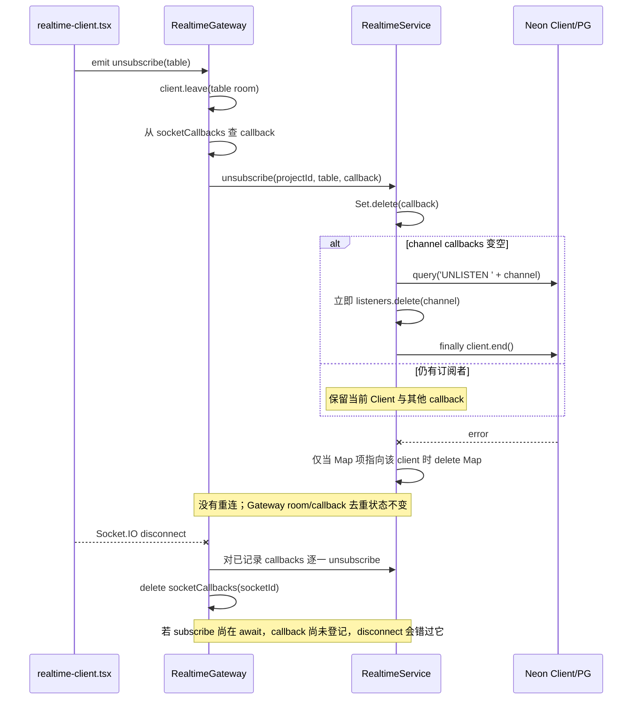
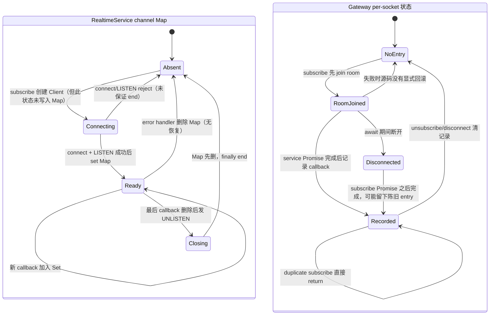

# Realtime 执行流程（当前源码）

本图描述仓库当前实现，不代表建议改造后的状态。所有路径均相对仓库根目录。

## 连接认证、订阅与通知

实际入口/方法：

- 浏览器连接及重连：`apps/web/src/features/realtime/realtime-client.tsx` 的 `io()`、`socket.on('connect')`。
- 握手认证：`apps/api/src/realtime/gateways/realtime.gateway.ts` 的 `handleConnection()`；项目 key 在 `apps/api/src/projects/projects.service.ts:32-40` 签发，期限 100 年。
- 订阅/退订：同 Gateway 的 `handleSubscribe()`、`handleUnsubscribe()`。
- DB 连接选择及 LISTEN：`apps/api/src/realtime/realtime.service.ts` 的 `getListenConnectionString()`、`subscribe()`。
- 触发器开关：`apps/api/src/realtime/realtime.controller.ts`；数据库 DDL/NOTIFY 在 `apps/api/src/realtime/trigger.service.ts`。

## 退订、断开和数据库错误：当前行为

正常共享语义：已有 channel 在 Map 中时，后续订阅把 callback 加进 `Set`，一个 PG 通知触发 callbacks；一个客户端正常退订只删自己的 callback，只有 callbacks 归零才发 UNLISTEN/关闭 DB Client。

当前故障语义：

- connect/LISTEN 失败时没有可靠的 room rollback/client close。
- 连接 error 时删 service Map，但没有重新 LISTEN；Gateway 的本地去重仍将该 socket 视为已订阅。
- 首次订阅被并发调用时，Map 尚无 connecting entry，会重复建 Client。
- Socket.IO 房间移除和数据库 listener 生命周期不是一个原子操作。
- 浏览器重连会重发本地 subscribedRef 中的表名，但当前 DB Client 断线本身不触发浏览器 socket 重连，也没有 event replay。

## 当前状态图

> `Connecting/Closing` 是为了表达实际 await/操作窗口的分析标签；源码的 `listeners` Map 只有 `{client, callbacks}`，没有状态字段，也没有在 connect 前占位。

## 修复目标图（建议状态，不是当前行为）

目标方案应以一个带 `state + generation + ready Promise + callbacks` 的 channel entry 为唯一事实源。先原子占位后初始化；所有失败路径 close；最后订阅退订后再结束 Client；socket 的 pending 操作携带取消标记；重连 READY 后 ACK 客户端。详情见 `recommendations.md` 和 `reliability-analysis.md`。
